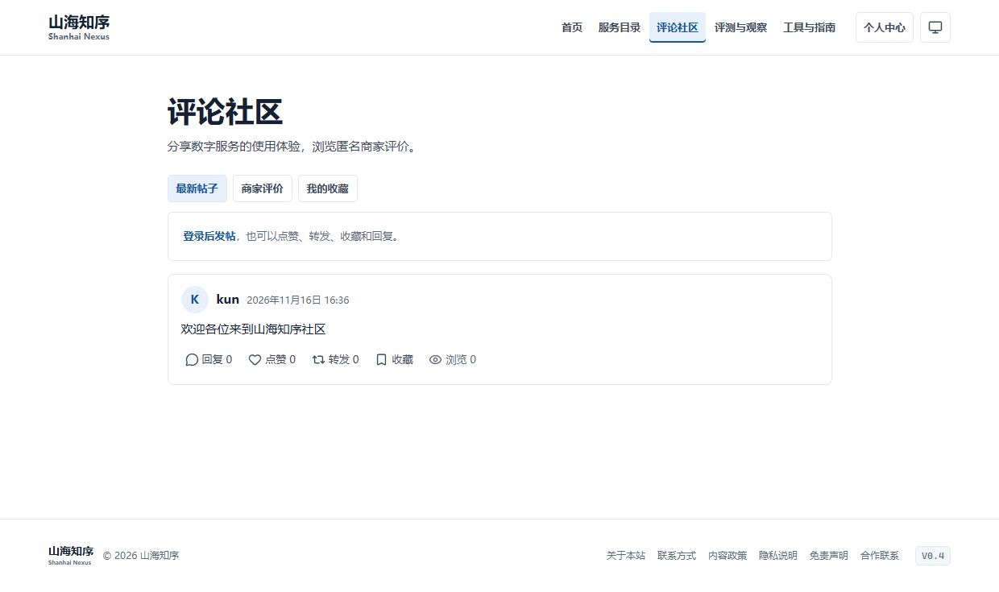
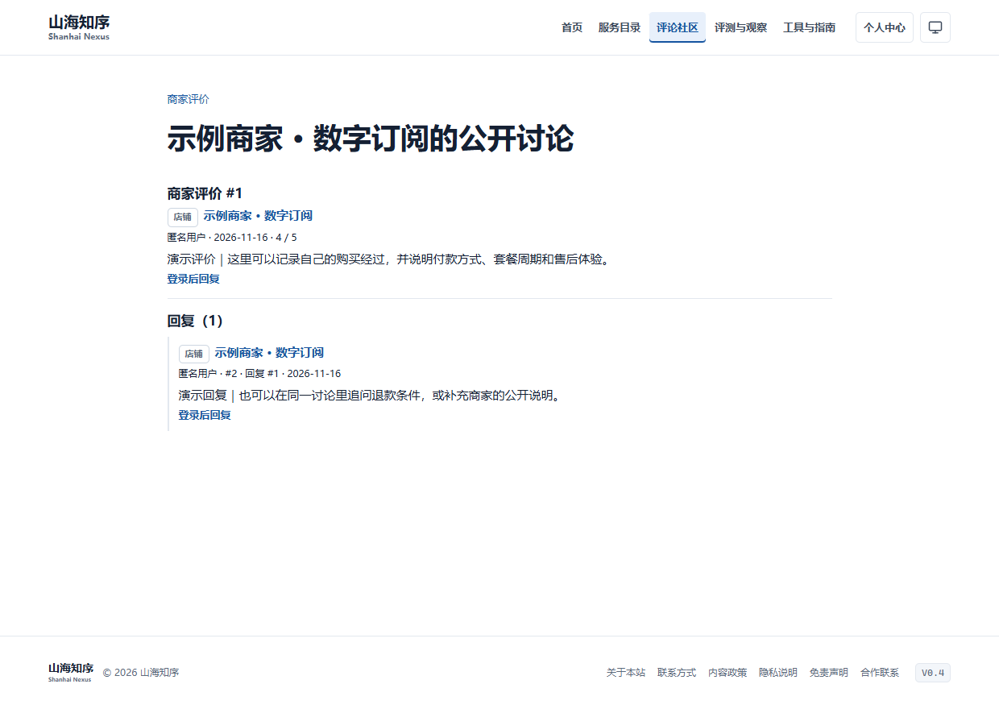
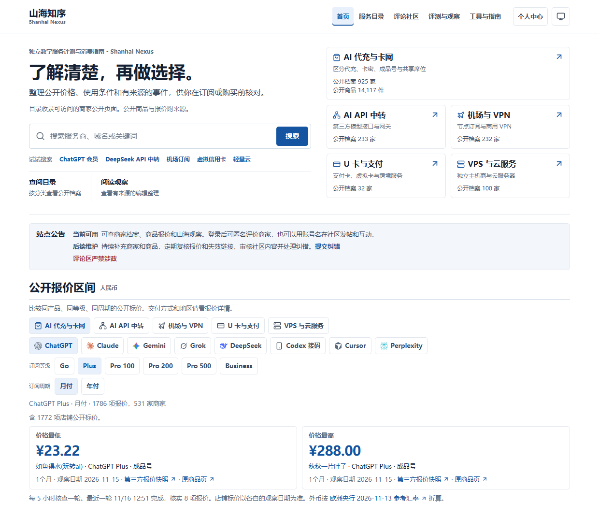

# 山海知序 · Shanhai Nexus · AI订阅信息及交流社区

**了解清楚，再做选择。**

山海知序是带有**评论社区**的中文数字服务目录。选 AI 订阅、API 中转、VPN 或跨境支付时，可以先查商家和公开报价，再看大家怎样评价实际体验。用过之后，你可以在商家页匿名打分，也可以到社区发帖提问、分享经过或回复别人的帖子。

截至 2026 年 11 月 16 日，正式站公开目录已收录 **1,538 家服务商**。AI 代充与卡网分类已收录 **14,117 件公开商品**。[完整服务目录](https://shanhainexus.com/services?group=all) · [首页商品统计](https://shanhainexus.com/)

**持续更新。** 我们会继续收录新商家和商品，定期复查公开报价和失效链接，并处理用户投稿与纠错。[提交商家或纠错](https://shanhainexus.com/contact)

[进入评论社区](https://shanhainexus.com/community) · [访问官网](https://shanhainexus.com) · [解决的痛点](#解决的痛点) · [核心模块](#核心模块) · [快速开始](#快速开始) · [许可证](#许可证)

## 评论社区

- **公开发帖**。用账号名发帖、回复和转发，可以附照片或视频。帖子显示浏览量，收藏只在个人账号中可见。
- **匿名评价商家**。登录后可对具体商家打分和留言。审核通过的评价会标注对应商家，也能从社区进入讨论。综合评分来自公开用户打分，同时显示评分人数。

**正式站 · 社区帖子流**



**本地运行 · 匿名商家讨论界面，使用示例留言**



## 解决的痛点

- **找一家店要翻多个网站。** 可以按商家、域名或商品名称搜索，沿来源链接回到原商品页或公开报价快照。
- **同名套餐容易比错。** 即使都是 ChatGPT Plus，代充、卡密与成品号的交付方式也不同。AI 订阅可按档位和周期筛选，API 报价按同一模型拆分输入和输出单价。
- **售后体验难查，也难追问。** 匿名评价关联具体商家，综合评分标明评分人数。可以在社区回复追问交付、退款或售后情况，也可以发帖分享自己的使用经历。

## 核心模块

| 模块 | 可以查看什么 | 入口 |
| --- | --- | --- |
| 评论社区 | 分享使用体验、查询匿名商家评价、参与讨论 | [浏览社区](https://shanhainexus.com/community) |
| AI 代充与卡网 | 店铺公开商品、ChatGPT／Claude／Gemini 等订阅报价，以及代充、卡密、成品号和共享席位的区别 | [浏览 AI 商家](https://shanhainexus.com/services?group=ai-retail) |
| AI API 中转 | 第三方模型接口的公开报价，按模型分别查看每百万输入和输出 Token 的单价 | [浏览中转站](https://shanhainexus.com/categories/ai-relay) |
| 机场与 VPN | 节点订阅、商用 VPN 的服务档案和有公开来源的套餐信息 | [浏览网络服务](https://shanhainexus.com/services?group=connections) |
| U 卡与支付 | 虚拟卡、跨境支付和数字订阅付款服务的公开信息 | [浏览支付服务](https://shanhainexus.com/categories/payments) |
| VPS 与云服务 | 主机商、云服务器和公开报价 | [浏览云服务](https://shanhainexus.com/categories/vps) |
| 山海观察 | 有来源的站方编辑文章及标明出处的第三方测评 | [阅读评测与观察](https://shanhainexus.com/observations) |
| 工具与指南 | 浏览器本地运行的 JSON、Base64、时间戳等工具，以及数字服务使用指南 | [打开工具](https://shanhainexus.com/tools) · [阅读指南](https://shanhainexus.com/guides) |

## 价格怎么读

- **先对齐商品。** 比较 AI 订阅时，先选品牌、档位和月付或年付。同一发卡平台上的独立店铺可以分别查看。
- **再核对报价。** 首页展示同一筛选范围内的人民币最低价和最高价。外币报价按参考汇率折算，商品页保留报价来源和观察日期。
- **最后回到原站。** 报价、库存、交付方式及退款条件以商家的商品页和结算页为准。商家评分来自已公开的用户评分，详情会显示评分样本数。

**正式站 · 首页和公开报价**



## 快速开始

当前版本 **V0.4**。使用 Next.js App Router、TypeScript、Tailwind CSS 和 SQLite。需要 Node.js 24 LTS 和 npm。

```bash
npm ci
npm run db:migrate
npm run dev
```

访问 [本地首页](http://localhost:3000) 或 [本地管理后台](http://localhost:3000/admin)。数据库默认创建在 `data/directory.sqlite`，初次启动导入 25 家带来源的示例档案。

- **本地配置**可将 `.env.example` 复制为 `.env.local`，将 `SITE_URL` 设为 `http://localhost:3000`。
- **管理后台**在启动前设置 `ADMIN_USERNAME`、`ADMIN_PASSWORD`、`ADMIN_SESSION_SECRET` 和 `ADMIN_ORIGIN`。密码至少 16 字符，签名密钥使用独立随机值，管理员来源填实际访问地址。
- **账号和模型**使用已有 FILEBOX 身份服务处理注册和登录。自托管时需配置获授权的 `FILEBOX_ACCOUNT_ORIGIN` 和独立的 `MEMBER_SESSION_KEY`。DeepSeek 文字审核由 `DSH_MODERATION_ENABLED` 启用。浏览目录、搜索和本地工具可直接使用。
- **容器部署**使用 [Docker Compose](docker-compose.yml)。将示例配置另存为 `.env`，设置自己的 `SITE_URL`、`ADMIN_ORIGIN`，再运行 `docker compose up -d --build`。容器端口绑定宿主机回环地址，由 HTTPS 反向代理提供公网入口。

```bash
npm run lint
npm run typecheck
npm test
npm run build
```

## 常见问题

### GitHub 仓库和线上网站有什么关系？

仓库提供应用源码、数据库迁移、可运行的初始档案和测试。线上目录还包含持续采集和编辑维护的资料。生产数据库、用户数据、运行密钥及第三方采集快照由站点单独管理。

### 目录收录代表什么？

收录表示有公开页面可查询。站方观察、第三方测评和用户反馈分别标注来源。购买前可以核对原始商品页、实际结算价和售后条件。

### 怎样纠正一条报价或补充一家店？

提交商家页面、原始报价和观察时间，便于编辑复查。线上表单可处理商家投稿、纠错和用户反馈。[提交反馈](https://shanhainexus.com/contact)

## 反馈与合作

- 使用问题、商家纠错和资料补充请访问[网站联系页](https://shanhainexus.com/contact)。
- 合作请联系 [beachwayt@gmail.com](mailto:beachwayt@gmail.com)。

## 许可证

山海知序采用[源码可见许可 1.0](LICENSE)。可用于学习、研究、个人自用和组织内部非商业部署。商业使用、面向第三方的公开托管，以及站点数据的批量复用需要书面授权。

- 第三方产品图标的版权和来源见[图标来源与许可证](public/ai-product-icons/SOURCE.txt)。
